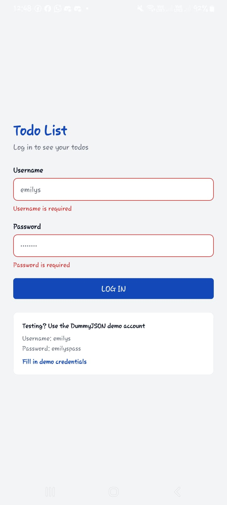
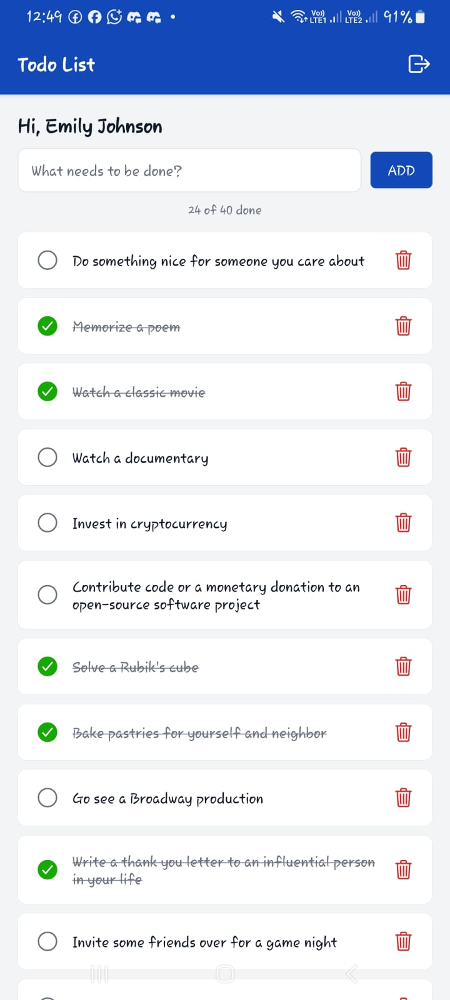

# Todo List

A small React Native todo app built with Expo, made as a learning project and portfolio piece. You log in, browse your todos with infinite scroll and pull-to-refresh, and add, complete or delete them. Every change shows instantly and rolls back if the request fails.

The focus is on production habits rather than features: typed API layers, normalized error handling, secure token storage with automatic refresh, protected routes, and a loading, error and empty state on every screen.

## Screenshots

Captured on an Android phone.

| Login (with validation) | Todo list |
| :---: | :---: |
|  |  |

## Stack

- [Expo](https://expo.dev) SDK 54 with [Expo Router](https://docs.expo.dev/router/introduction/) 6 (file-based routing)
- React Native 0.81, React 19, TypeScript 5.9 (strict, no `any`)
- [Axios](https://axios-http.com) for HTTP, with request and response interceptors
- [expo-secure-store](https://docs.expo.dev/versions/v54.0.0/sdk/securestore/) for tokens (Keychain on iOS, Keystore on Android)
- [DummyJSON](https://dummyjson.com) as the backend

## Project structure

```
app/          Routes only: thin files that render a screen (+ the root layout)
pages/        Screens: auth/Login, todos/List
components/   Reusable UI: ui/ (AppButton, AppTextInput, StateMessage),
              todos/ and auth/ for feature-specific pieces
hooks/        State logic: useAuth (session context), useTodos (list + mutations)
services/     API calls, one function per endpoint
types/        TypeScript types for every API payload and response
utils/        Shared Axios instance, error normalizer, secure token storage
constants/    Colour tokens
```

**Why routes are separate from screens:** Expo Router treats every file in `app/` as a route, so anything placed there becomes navigable. Keeping `app/` to one-line route files means:

- the URL structure is visible at a glance
- screens in `pages/` can be moved, renamed or reused without changing URLs
- helper components can never become routes by accident

The other folders follow the same idea. A screen reads state from a hook, the hook calls a service, and the service uses the shared Axios instance. Each layer can be read and tested on its own.

## How auth works

1. **Login.** `services/auth.ts` posts to `/auth/login`. The access and refresh tokens are saved with `expo-secure-store`, never in plain AsyncStorage.
2. **Attaching the token.** A request interceptor in `utils/api.ts` reads the access token and sends it as `Authorization: Bearer <token>`.
3. **Refreshing on 401.** When a request gets a `401`, the response interceptor:
   - calls `/auth/refresh` once, saves the new tokens and replays the original request
   - if several requests fail at the same time, makes them all wait for the **same** refresh call instead of starting their own
   - never retries a request more than once, and skips the login and refresh endpoints, so a failing refresh can't loop
   - if the refresh fails, clears the tokens and signs the user out
4. **Protected routes.** The root layout uses `Stack.Protected`. Signed-out users can only reach `/login`, and signed-in users skip it. Logging in or out switches screens automatically, with no manual navigation.
5. **App start.** `useAuth` checks for a saved session while the splash screen is still showing, so the wrong screen never flashes.

`utils/api.ts` doesn't import the auth service directly. `AuthProvider` passes the refresh and sign-out functions in through `setAuthHandlers`, which avoids a circular import between the two modules.

## A note on DummyJSON writes

DummyJSON **simulates** add, update and delete requests: it returns a realistic response but doesn't save anything. So:

- Changes disappear when you pull to refresh or restart the app.
- Every added todo comes back with the same id, and updating or deleting it returns `404`. The app gives added todos a unique local id, and toggles or deletes them on the device only.

## Running it

You'll need Node.js and either the [Expo Go](https://expo.dev/go) app, an iOS simulator or an Android emulator.

```bash
# 1. Install dependencies
npm install

# 2. Create your env file (points the app at DummyJSON)
cp .env.example .env

# 3. Start Expo, then press i (iOS), a (Android), or scan the QR code with Expo Go
npx expo start
```

Log in with DummyJSON's demo account. The login screen can fill it in for you.

- **Username:** `emilys`
- **Password:** `emilyspass`

Useful scripts:

```bash
npx tsc --noEmit   # type check
npm run lint       # ESLint (expo lint)
```

> **Web isn't supported for login.** `expo-secure-store` only works on iOS and Android, so the session can't be saved in a browser.

**Tip for testing the token refresh:** set `expiresInMins` to `1` in `services/auth.ts`, log in, wait a minute, then pull to refresh. The list should reload without sending you back to the login screen.
